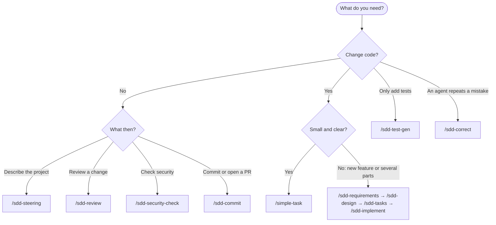
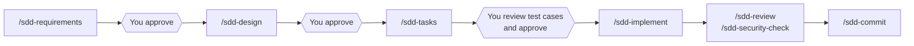

# Quick Guide

This guide shows which Skill to use for a task, and how to combine Skills into a workflow. For setup details, see the [Installation Guide](INSTALL-GUIDE.md). For the full rules, see [Workflow](WORKFLOW.md).

## Before you start

1. Install sdd-mcp once: `npx -y sdd-mcp-server@latest setup-global`. Or install it in one project: `npx sdd-mcp-server@latest install --profile lean --target claude-code`.
2. Reload or restart your host (Claude Code, Codex, or Oh My Pi).
3. Accept the project trust prompt.

You use Skills only. You do not call MCP tools, and you do not paste workflow JSON. Each Skill restores its saved state when it starts.

**A Skill is missing?** Your installed Skills are older than the package. For example, `/sdd-correct` arrived in 6.1.0. Run `setup-global` again (or `install` again in the project), then reload the host.

## How to call a Skill

Each host uses a different prefix. This guide uses the Claude Code form.

| Host | Form | Example |
|---|---|---|
| Claude Code | `/<skill>` | `/sdd-requirements user-export` |
| Codex | `$<skill>` | `$sdd-requirements user-export` |
| Oh My Pi | `/skill:<skill>` | `/skill:sdd-requirements user-export` |

## Pick a Skill

| I want to... | Use |
|---|---|
| Fix a bug, or make a small change with clear behavior | `/simple-task` |
| Build a feature that needs requirements, design, or several parts | `/sdd-requirements`, then the next phases |
| Add tests to code that has none | `/sdd-test-gen` |
| Get a review of my change | `/sdd-review` |
| Check my change for security flaws | `/sdd-security-check` |
| Commit, or prepare a pull request | `/sdd-commit` |
| Describe this project for the agent (stack, layout, commands) | `/sdd-steering` |
| Add a project rule for one area, such as an API or database layer | `/sdd-steering-custom` |
| Stop an agent from making the same mistake again | `/sdd-correct` |

## Skills one by one

### `/simple-task`

- **Use for:** a bug fix, a refactor, or a small feature with clear expected behavior.
- **Example:** `/simple-task Fix the date parser so it accepts ISO week dates`
- **What it does:** it writes a failing test, makes the smallest fix, and cleans up. It runs the test at each step.
- **You get:** changed files, the failing and passing test output, and checks it could not run.
- **Do not use for:** work that needs a design decision or touches several components. Use the formal workflow.

### `/sdd-requirements`

- **Use for:** the first phase of a feature. Give a feature name and a goal.
- **Example:** `/sdd-requirements user-export Let users export their data as CSV`
- **What it does:** it writes testable requirements, each with acceptance criteria, and validates them.
- **You get:** `.spec/specs/<feature>/requirements.md` and the question **"Approve these requirements?"**

### `/sdd-design`

- **Use for:** the second phase, after you approve the requirements.
- **Example:** `/sdd-design user-export`
- **What it does:** it maps each requirement to a design decision, with interfaces, failure behavior, and verification.
- **You get:** `design.md` and the question **"Approve this design?"**

### `/sdd-tasks`

- **Use for:** the third phase, after you approve the design.
- **Example:** `/sdd-tasks user-export`
- **What it does:** it splits the design into small ordered tasks. Each task has acceptance criteria and a test-first plan.
- **You get:** `tasks.md`. It asks once whether you want to review test cases. Then it asks **"Approve these implementation tasks?"**

### `/sdd-implement`

- **Use for:** the last phase, after you approve the tasks. Also use it to continue after a break.
- **Example:** `/sdd-implement user-export`
- **What it does:** for each task, it writes a failing test (RED), makes it pass (GREEN), cleans up, and runs the final check. The server runs the test commands itself and records the real exit codes.
- **You get:** task states, the changed files, and the test results for each step.

### `/sdd-test-gen`

- **Use for:** adding focused tests to existing behavior, without the full workflow.
- **Example:** `/sdd-test-gen Cover the retry limits in src/http/client.ts`
- **You get:** new tests, proof that each test can fail, and the passing run.

### `/sdd-review`

- **Use for:** a review of a diff, a branch, or a pull request before you merge.
- **Example:** `/sdd-review the current branch against develop`
- **What it does:** it checks correctness, regressions, security, and maintainability. It removes false positives.
- **You get:** findings ranked critical, important, minor, each with a file, a line, and a fix. It does not edit code unless you ask.

### `/sdd-security-check`

- **Use for:** changes that touch input handling, authentication, secrets, commands, or files.
- **Example:** `/sdd-security-check src/api/upload`
- **You get:** findings ranked critical to low, each with evidence, impact, a fix, and a regression test. It does not probe live systems.

### `/sdd-commit`

- **Use for:** committing verified work, or writing a pull request description.
- **Example:** `/sdd-commit`
- **What it does:** it reviews the staged diff, checks that tests passed, and writes a commit in the repository's style. It never stages secrets or unrelated files.

### `/sdd-steering`

- **Use for:** the first time you use sdd-mcp in a repository, or after a large change to the stack or layout.
- **Example:** `/sdd-steering`
- **You get:** `.spec/steering/product.md`, `tech.md`, and `structure.md`. The facts come from the repository, and it keeps text you wrote.

### `/sdd-steering-custom`

- **Use for:** a rule that applies to one area, such as "all API handlers validate input with zod".
- **Example:** `/sdd-steering-custom api-handlers.md Rules for HTTP handlers in src/api`
- **You get:** one steering file. It loads always, only for matching files, or only when you ask.

### `/sdd-correct`

- **Use for:** an agent that makes the same mistake again.
- **Example:** `/sdd-correct The agent keeps editing generated files under .claude/`
- **What it does:** it logs the mistake in `.spec/corrections.md`. Then it adds the strongest fix it can: a type or engine check first, then a lint or CI check, then a test. It adds rule text only as the last step, and only with your approval.

### `/output-clarity-ladder`

- **Use for:** nothing. The model applies it on its own to explanations and summaries.
- **What it does:** it keeps replies plain and easy to check. It uses a diagram or a page when that is clearer.

## Combined workflows

### Start in a new repository

1. `/sdd-steering` writes the project description.
2. Read the three steering files and correct any wrong fact.
3. Optional: `/sdd-steering-custom` for area-specific rules.

### Fix a bug

1. `/simple-task <what is wrong and what should happen>`
2. `/sdd-review` the change.
3. `/sdd-commit`

### Build a feature

1. `/sdd-requirements <feature> <goal>`. Read the requirements, and answer the approval question.
2. `/sdd-design <feature>`. Approve the design.
3. `/sdd-tasks <feature>`. Review the test cases if you chose to, then approve the tasks.
4. `/sdd-implement <feature>`. It works through the tasks in order.
5. `/sdd-review`, and `/sdd-security-check` when the change touches security.
6. `/sdd-commit`

Each phase waits for your explicit "yes". If you run a later phase too early, the Skill shows what blocks it and changes nothing.

### Continue after a break

Run the Skill for the phase you were in, for example `/sdd-implement user-export`. It reads the saved state from `.spec/specs/<feature>/spec.json` and continues from the last recorded step. It does not depend on the chat history.

### Add tests before a refactor

1. `/sdd-test-gen` for the behavior you will change.
2. `/simple-task` for the refactor. The new tests protect the behavior.
3. `/sdd-commit`

### Fix a repeated agent mistake

1. `/sdd-correct <the mistake>`
2. Approve or decline any proposed rule text.
3. `/sdd-commit`

## Things to know

- **Approvals are yours.** Only a clear "yes" to the Skill's question approves a phase. A tool permission prompt is not an approval.
- **The saved record is the authority.** `.spec/specs/<feature>/spec.json` holds the workflow state. Chat text and checkboxes in Markdown do not count as progress.
- **Hand edits are detected.** If you edit an approved document by hand, the workflow stops and reports the drift. Run that phase's Skill again to revise it.
- **Test results are real.** In the default `verified` mode, the server runs each test command and records the exit code it sees. To go back to the 5.5.0 behavior, set `SDD_EVIDENCE_MODE=self-reported`. See [Verified execution evidence](WORKFLOW.md#verified-execution-evidence).
- **Project settings** live in `.spec/sdd-config.json`. For example, `evidence.verifyCommand` sets the command that each task's final check runs.

## Read more

- [Workflow](WORKFLOW.md): the full rules, evidence settings, and the optional JEV advisory.
- [Installation Guide](INSTALL-GUIDE.md): setup, profiles, upgrades, and troubleshooting.
- [Model Routing](MODEL-ROUTING.md): which model and effort each Skill uses.
