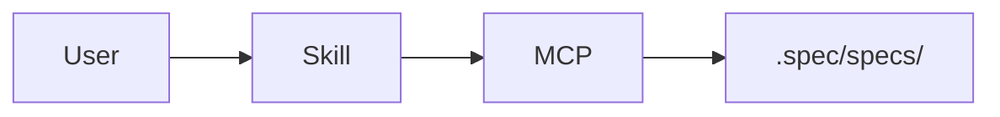
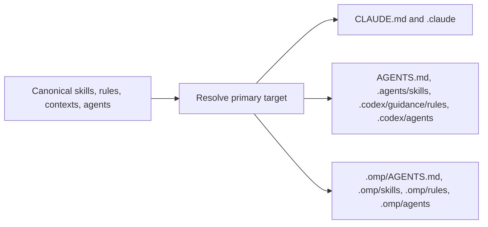
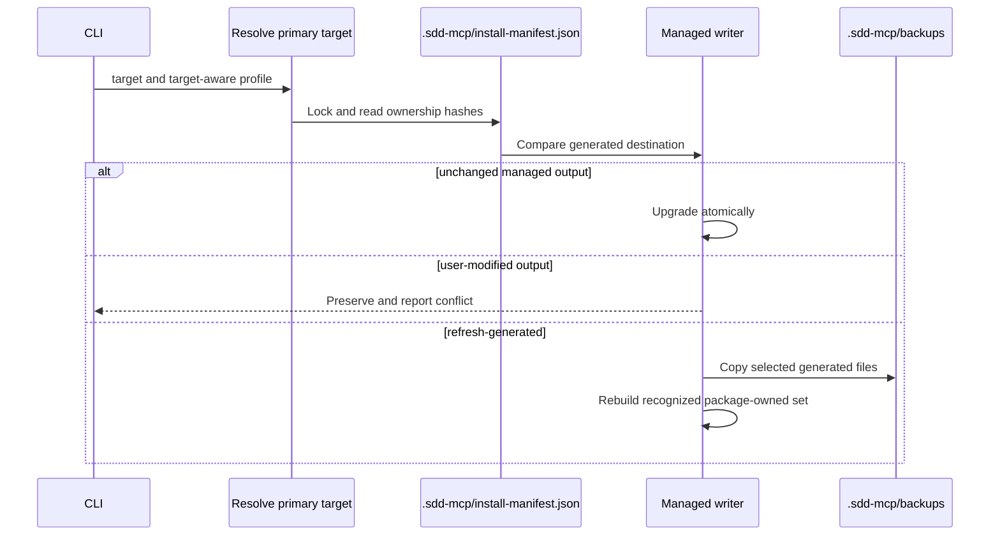

# SDD-MCP Workflow

SDD-MCP uses one durable workflow. It renders that workflow for Claude Code, Codex, and Oh My Pi (OMP). Users run manual-only workflow Skills. The registered MCP runtime stays behind the Skill boundary.

## Start in the host

1. Run `npx -y sdd-mcp-server@latest setup-global` once per local user or OMP profile. From a POSIX source checkout, run `./bootstrap.sh` instead. You can select one host with `--target claude-code`, `--target codex`, or `--target omp`. A repository-scoped or team-scoped `install` is an alternative, not a required second step. If you want personal scope, do not run `install` in the `sdd-mcp-server` checkout.
2. Reload or restart the host, and accept project trust. Claude organization or project `ask` or `deny` rules can still take precedence.
3. Invoke the native Skill:

| Path | Claude Code | Codex | OMP |
|---|---|---|---|
| Small change | `/simple-task` | `$simple-task` | `/skill:simple-task` |
| Formal SDD | `/sdd-requirements <feature>` | `$sdd-requirements <feature>` | `/skill:sdd-requirements <feature>` |

Continue Formal SDD with the same host prefix for `sdd-design`, `sdd-tasks`, and `sdd-implement`. Do not call backend tools. Do not paste workflow JSON. Each Skill restores durable state and approved compact context.

Personal runtime files are `~/.claude.json` (or `<CLAUDE_CONFIG_DIR>/.claude.json`), `~/.codex/config.toml` (or `<CODEX_HOME>/config.toml`), and `<omp config path>/mcp.json`. Personal Skills live in `~/.claude/skills/` (or `<CLAUDE_CONFIG_DIR>/skills/`), `~/.agents/skills/`, and `<omp config path>/skills/`. OMP defaults to `~/.omp/agent`. OMP needs one setup per named profile. Global setup leaves Claude permissions unchanged. It installs no repository guidance and no agents. Its scope is the local machine or profile. It is not Claude cloud or Cowork Skill distribution.

Verify with `claude mcp get sdd-mcp`, `codex mcp get sdd-mcp`, or OMP `/mcp test sdd-mcp`. Run the command from a directory that is not this package checkout and has no project `sdd-mcp` entry. Project entries in `.mcp.json`, `.codex/config.toml`, and `.omp/mcp.json` win. Remove only that entry yourself. In this checkout, the pinned `npx` command exits with `sh: sdd-mcp-server: command not found`. This lasts until `node_modules/.bin/sdd-mcp-server` executes `node ./sdd-entry.js`. Skill-name precedence is a separate host rule. See the [installation guide](INSTALL-GUIDE.md#one-time-personal-setup) for exact overrides, OMP fallback, ownership, and safe reruns.

The runtime resolves project operations from a nonempty `CLAUDE_PROJECT_DIR`. Otherwise it uses its working directory. Specifications and approvals stay in that project's `.spec`. Personal setup does not create workflow state in the user configuration directory.

## Formal phase flow



The Skill-governed journey is:

1. Requirements resolves the feature. It initializes a named missing feature. It presents clarification questions when needed. Otherwise it resumes or selects incomplete work without relying on process memory.
2. Requirements creates the canonical artifact and submits it internally. Deterministic validation must pass before the Skill asks the human to approve.
3. Design and tasks each load the latest approved compact context. Each creates and submits its artifact and presents validation. Each then asks a separate explicit approval question.
4. Tasks asks once whether test-case review is required. When test-case review is enabled, the human confirms the presented cases. That confirmation is one human gate. Tasks approval is another.
5. Implementation resumes persisted task state. It internally records observed RED, GREEN, blocking, affected artifacts, and final verification.

Only an unambiguous affirmative response inside the active phase Skill can approve that exact revision. Host permission is not approval. If you invoke a later Skill early, it presents the persisted blocker. It makes no file change.

Requirement metadata accepts inline values. It also accepts values on lines below their labels. For example, a numbered list may follow `**Acceptance Criteria:**` on the label line or on later lines. The runtime accepts this documented shape starting in 5.0.1, and the `sdd-requirements` Skill describes both forms.

A design may add an optional `## Interface Spike` section when two interface shapes are both plausible. The spike is throwaway code under `.spec/specs/<feature>/spike/` that production code never imports. The section names the question, the path, and the decision it settled. Validation ignores the extra heading, and approval still needs the explicit human answer. See the [Requirements Reference](../skills/sdd-requirements/REFERENCE.md) for the complete document shape.

## Durable authority and continuation

`.spec/specs/<feature>/spec.json` is the sole workflow authority. Phase Markdown is human-readable governed input. `context/handoff.md` is a bounded, rebuildable cache. Skills load approved context by default. A Skill loads a failed or unapproved draft only when asked, in full mode, for revision. That draft never leaks into later approved context.

Durable status decides the next action across sessions. The next action can be to submit or revise a phase, request approval or review, or begin implementation. It can also be to continue or select a task, report an artifact-drift blocker, or complete. Approved artifact drift blocks the workflow. The runtime does not silently overwrite the reviewed bytes. Implementation completion comes only from persisted task states. It never comes from chat output or task checkboxes.

## Responsibility boundary

| Layer | Owns |
|---|---|
| User | Goals, clarification, explicit test-review and phase-approval decisions |
| Skill | Method, artifact composition, concise validation presentation, human gates, and host-native invocation |
| MCP runtime | Feature identity, canonical writes, deterministic structure/traceability gates, revisions/hashes, approvals/checkpoints, task progress, recovery, and handoff |
| `.spec` | Durable workflow record and readable artifacts |

Target renderers add only native invocation and model metadata. They do not duplicate this choreography.

## Output clarity skill

`output-clarity-ladder` is the only model-invocable skill. The model applies it to explanation, summary, and teaching replies. The user does not type a command. It has no agent route, so it always runs in the current reply.

- **Writing (default):** about 80% of the way to ASD-STE100. Write one idea per sentence. Name the actor. Use one word for one thing. Keep every number and condition.
- **Ladder:** writing, then a diagram, then a self-contained HTML page, then an explainer video. The model moves up only when the next format makes the same facts easier to understand. A requested artifact, such as an email or code, keeps its form.
- **Languages:** `SKILL.md` holds the English rules. `references/` holds Japanese (`ja`) and Traditional Chinese (`zh-TW`) guidance. Any other language uses the English rules. The reply uses the user's language.
- **Limits:** there is no approved-word check. The output is not ASD-STE100 conformant. The skill never asks the user to paste a secret into chat.

MCP runtime blockers and errors follow the same writing rules. Each message has at most 2 sentences. Each sentence has at most 25 words. When the user can act, the message gives a next action. Error codes do not change.

## Optional project-native guidance flow



| Component | Claude Code | Codex | OMP |
|---|---|---|---|
| Skills | `.claude/skills` | `.agents/skills` | `.omp/skills` |
| Rules | `.claude/rules` with `paths` | `.codex/guidance/rules` pointers | `.omp/rules` with `globs`, `alwaysApply: false` |
| Agents | `.claude/agents` | `.codex/agents` | `.omp/agents` |
| Contexts | `.claude/contexts` | `.codex/guidance/contexts` | `.omp/contexts` |

Rules and references are progressive guidance. They are not always-on workflow authority. Mandatory checks stay in the invoked skill and the MCP state machine.

Claude Code and Codex may install only their supported lifecycle or hook integration. OMP does **not** execute packaged Markdown as a hook. This project claims no native executable OMP hook. An explicit `--target omp --hooks` request fails.

## Model execution during a skill

### Claude Code

The invoked skill applies its resolved model and effort in the current turn. The defaults are `claude-opus-5-5`/high for high-level work and `claude-sonnet-5-5`/medium for implementation and TDD. Installed `.claude/agents` subagents receive the same per-role metadata. The skill does not spawn a specialist only to change models.

### Codex

Implementation and TDD run inline on the parent. Generated agent definitions default to `gpt-6-luna`/medium. They do not switch that parent. Review and security skills may use one generated custom agent (default `gpt-6-sol`/xhigh). The user must choose it once per session first. The child cannot nest. When delegation is unavailable, the skill records a single fallback and continues inline. The repository cannot force a model switch when the host does not honor the request.

### Oh My Pi

OMP runs invoked SDD skills inline. The installed `.omp/extensions/sdd-skill-routing.js` switches the parent to the role's configured model and thinking level for that skill turn. The defaults are `openai-codex/gpt-6-sol`/xhigh and `openai-codex/gpt-6-luna`/medium. The extension then restores the prior route. Automatic high-effort children are intentionally disabled, because real A/B runs increased median cost. A user may explicitly opt into one generated `.omp/agents` advisor. That child has no spawn capability, no nesting path, and no retry path. Implementation, TDD, and simple tasks also stay inline. They change only when at least two independent slices are truly dispatched concurrently.

Pass `--model-roles <file>` at install time to override SDD role models and efforts per host. The installer validates the YAML before it writes. Generic host agents stay unchanged. OMP requires project extension discovery. If the model is unavailable, the invocation aborts instead of falling back. See [MODEL-ROUTING.md](MODEL-ROUTING.md#configure-installed-model-routes) for the six role keys, selector syntax, and the Claude/Codex/OMP execution boundaries.

## Installation and migration flow



The two operator journeys are different on purpose:

- **New project:** install the chosen target with the lean or full profile. Do not pass `--refresh-generated`. Runtime registration is mandatory.
- **Upgrade from sdd-mcp 3.x or 4.x:** keep the repository. Select the host that will execute v5. Run one `--refresh-generated` migration. Review `.sdd-mcp/backups/` and conflicts. Omit the flag on later v5 updates.

An old OMP-via-Codex project must select `--target omp`. The installer preserves Codex TOML agents. It never treats them as executable OMP agents. See [INSTALL-GUIDE.md](INSTALL-GUIDE.md) for target mapping and commands.

## Verified execution evidence

The server runs each task's test command itself and records what it observed. The agent never types an exit code. This closes the gap where a RED, GREEN, or COMPLETE record could carry an exit code that no command produced.

### How a task record works

- A RED, GREEN, or COMPLETE record carries the test command as `run.argv`: the program first, then its arguments. The `sdd-implement` Skill supplies it; the user does not operate the tool.
- The server runs the command in the project root with no shell, with a timeout, and with a bounded output capture. It records the observed exit code, a SHA-256 of the output, the duration, and an 8 KB excerpt of the last output. Secrets are redacted from the excerpt before it is saved.
- RED needs a non-zero exit code. GREEN and COMPLETE need zero. When the observed code does not fit the action, the result is `TaskTransitionInvalid`, the error details carry the observation, and `spec.json` is unchanged.
- The RED excerpt is classified `setup`, `assertion`, or `ambiguous`. Named patterns cover JavaScript and TypeScript, Python, Go, Rust, JVM, and .NET output; setup wins when both kinds match. After a `setup` or `ambiguous` RED, the agent can fix the test and record RED again; the new observation replaces the old one. An `assertion` RED is final. GREEN is rejected with `RedSetupFailure` while the latest RED is `setup`.
- The JEV `red` check runs after RED is recorded and judges the persisted excerpt, not a summary the agent wrote. It needs no `evidence` input in that case. When a task is in progress with neither an engine RED nor `evidence`, the check returns `InvalidParams` and names the fix.
- One evidence command runs per feature at a time. A second task action for the same feature waits up to 2 s for the evidence-run lock and then reports `RevisionConflict` or `LockTimeout`; it never starts a second command.
- The command runs outside the feature lock. Status, JEV checks, and the handoff stay readable while it runs. The transition is checked before the run and again before the result is saved.
- A host must wait for the tool result at least as long as the longest command. The Codex registration sets `tool_timeout_sec = 660`; Codex otherwise stops waiting after 60 s.

### Settings

| Setting | Meaning |
|---|---|
| `SDD_EVIDENCE_MODE` | `verified` (default) or `self-reported`. In `self-reported` mode the 5.5.0 evidence object is accepted and saved with `source: "caller"`. |
| `SDD_EVIDENCE_TIMEOUT_MS` | Timeout for one command in milliseconds. The default is 120000. The limits are 5000 and 600000. |
| `.spec/sdd-config.json` | Optional project settings: `{"evidence":{"mode":"verified","timeoutMs":120000,"allowedCommands":["npm","npx"],"passEnv":["MY_TEST_TOKEN"],"verifyCommand":["npm","test"]}}`. |
| `evidence.verifyCommand` | Optional argv that the server runs at COMPLETE in verified mode. COMPLETE may then omit `run`; a different `run` is rejected with `VerifyCommandMismatch`. The value must pass the allowlist and the inline-code rule, or it is ignored with one warning. There is no environment override. `sdd-status` and the handoff show it. |

The environment variable wins over the project setting. An unrecognized value falls back to the default, and the tool result carries one warning. `sdd-status` reports the resolved `evidenceMode`.

### Allowed programs and environment

- The program in `run.argv[0]` must be on the allowlist after its directory and any `.cmd`, `.exe`, or `.bat` suffix are removed. The default list is `node`, `npm`, `npx`, `pnpm`, `yarn`, `bun`, `jest`, `vitest`, `tsc`, `pytest`, `python`, `python3`, `go`, `cargo`, `make`, `mvn`, `gradle`, and `dotnet`. `evidence.allowedCommands` replaces it. Shells such as `sh` and `bash` are never allowed, and `argv` is never interpreted by a shell. One exception exists on Windows: a program that resolves to a `.cmd` or `.bat` file (`npm`, `npx`, `yarn`, `pnpm`) cannot start without `cmd.exe`, so it runs through `cmd.exe /d /s /c` under its original name, with every argument quoted and every `cmd` metacharacter escaped. An argument that contains a line break is rejected on every platform, because a line break would end the `cmd.exe` command line.
- Inline code is rejected with `EvidenceCommandInlineEval`, because a typed exit code could hide in it. The rule covers `node`/`bun` `-e`, `--eval`, `-p`, and `--print`; `python`/`python3` `-c`; and `npx`/`npm exec` running one of those interpreters with such a flag. Put the code in a script file and run the file instead.
- The test process receives the server environment without `SDD_JEV_API_KEY` and without any variable whose name ends a word with `KEY`, `TOKEN`, `SECRET`, `PASSWORD`, `PASSWD`, or `CREDENTIAL(S)` (joined forms such as `OPENAI_APIKEY` included) or holds `PAT` as a word. Names listed in `evidence.passEnv` pass through. `CI=1` is set when `CI` is unset.

### Errors

| Code | Meaning | What to do |
|---|---|---|
| `SelfReportedEvidenceRejected` | Verified mode is on and the record carried an evidence object but no `run`. | Pass the command as `run.argv`, or set `SDD_EVIDENCE_MODE=self-reported`. |
| `EvidenceCommandNotAllowed` | The program is not on the allowlist. | Use an allowed test runner or add the program to `evidence.allowedCommands`. |
| `EvidenceRunTimedOut` | The command did not finish within the timeout. Nothing was saved. | Narrow the test selection or raise `SDD_EVIDENCE_TIMEOUT_MS`. |
| `EvidenceRunnerUnavailable` | The server has no evidence runner wired in. | Report the installation problem; this does not happen with the packaged server. |
| `EvidenceCommandInlineEval` | The command runs inline code (`-e`, `--eval`, `-p`, `--print`, or `-c`). | Put the code in a script file and run the file. |
| `RedSetupFailure` | GREEN was recorded while the latest RED is classified `setup`. | Fix the test setup so the test fails on an assertion, then record RED again. |
| `EvidenceContinuityViolation` | GREEN ran a different command than RED (`argv-mismatch`), or the working tree did not change since RED (`unchanged-tree`). | Run the RED command again for GREEN, after changing files. |
| `ObservedArtifactMismatch` | A completion artifact did not change since the task started. The details list up to 20 paths. | Remove the listed paths, or make the change first. |
| `VerifyCommandMismatch` | COMPLETE carried a `run` that differs from `evidence.verifyCommand`. | Omit `run`, or pass the configured command. |

### Evidence binding

When the project is a git repository, the server binds evidence to the working tree. A binding is a SHA-256 over the `HEAD` tree plus every dirty or untracked path and its content hash. `.spec/specs/` and `.spec/reviews/` are left out, so workflow writes do not count as changes. Observation has a 10 s deadline and at most 2,000 dirty paths; beyond that the binding is `unavailable`.

- **Start:** `start` stores the tree as `start_tree` on the task.
- **Continuity:** GREEN must run the same `argv` as RED, and the tree must differ from the RED tree. Otherwise the result is `EvidenceContinuityViolation`.
- **Artifact cross-check:** each completion artifact must be a path that changed since `start_tree`, or a directory that contains one. A path under `.spec/specs/` only needs to exist. Otherwise the result is `ObservedArtifactMismatch`, and the verify command does not run.
- **Drift:** `sdd-status` for one feature compares the live tree with the latest verified completion. It reports `verificationDrift` with the task number and up to 50 changed paths, or `verificationBinding: "unavailable"` when the tree cannot be compared. It never writes `spec.json`. The feature list view skips this check. `sdd-commit` shows drift and labels the commit content unverified.

Every check skips when a binding is `unavailable` or the project is not a git repository, so the 6.0.0 behavior applies there. `sdd-status` reports `binding: "bound"` or `"unbound"` per task.

### Parallel slices

Parallel slices need one git worktree per slice, because a binding covers one working tree. While evidence mode is `verified`, `sdd-implement` does not offer parallel project-agent mode, so slices run serially. The implementer agent works only in its assigned worktree and returns a blocker when none is assigned.

### Compatibility and rollback

- Evidence entries in `spec.json` stay on schema version 5. New fields (`source`, `argv`, `output_sha256`, `duration_ms`, `output_excerpt`, `truncated`, `redactions`, `red_classification`) are added only to engine-observed entries. An entry without `source` is read as `caller`.
- `sdd-status` reports the source of each recorded entry per task, and the handoff marks each completed task `(verified)` when every entry was engine-observed and `(self-reported)` otherwise. Features without evidence render as before.
- The binding fields (`start_tree` on a task and `working_tree` on an evidence entry) are optional, so specs written before them still load.
- To roll back, set `SDD_EVIDENCE_MODE=self-reported`. Specs written in verified mode stay readable.

## Corrections

When an agent repeats a failure, invoke `sdd-correct` (`/sdd-correct`, `$sdd-correct`, or `/skill:sdd-correct`). It logs the symptom in `.spec/corrections.md` and fixes it at the strongest feasible tier: structure (types, data shape, or an engine gate), then lint, type, or CI, then a test, and only then rule or Skill text. Rule or Skill text needs a second occurrence, or an irreversible or security-relevant failure, and explicit approval. The Skill also proposes deleting lines that the fix makes obsolete. The log is never loaded into feature context.

### Skill changes

A structural Skill edit changes a Skill's method, gates, stop rules, or output contract. Before one merges, run the blind-test kit in `evals/skills/` against the base branch and the change, and paste the result table into the pull request. A lower pass rate on any checklist item needs a reason or a fix. Wording-only edits do not need the kit. See `evals/skills/README.md` for the run steps and the blinding procedure.

## Optional JEV advisory

JEV is an optional, advisory check. It calls the TypeSafe Jev decision API to judge meaning that the structural gates cannot judge. It is off by default. When it is off, the workflow behaves as before and JEV creates no files.

JEV never changes approval, validation, the next action, or `spec.json`. A person still makes every decision. A result is advice only.

### Turn it on

| Setting | Meaning |
|---|---|
| `SDD_JEV_ENABLED` | `1`, `true`, `yes`, or `on` enables JEV. Any other value disables it. |
| `SDD_JEV_API_KEY` | Your API key. JEV reads the key only from this environment variable. |
| `SDD_JEV_ALLOW_CODE` | Same values as above. Required before JEV sends any code excerpt. |
| `SDD_JEV_TIMEOUT_MS` | Request timeout in milliseconds. The default is 5000. The limits are 1000 and 15000. |
| `.spec/sdd-config.json` | Optional project setting: `{"jev":{"enabled":true}}`. It never holds a key. |

The environment variable wins over the project setting. The project setting applies only when `SDD_JEV_ENABLED` is unset. JEV needs both the switch and a key. It never writes the key to a sidecar, a log, an error message, or a tool response.

JEV sends each request to one fixed HTTPS endpoint. It makes one attempt, follows no redirect, and never retries.

### Checks

| Check | When it runs | Data sent |
|---|---|---|
| `requirements` | After validation passes, before approval | Requirement text and the feature goal |
| `design` | After validation passes, before approval | Design decisions and the requirements they cover |
| `testcases` | After tasks validation, before the test-case or approval question | Task text and the planned test cases |
| `red` | After the RED record | Test command, the engine's output excerpt (or the caller summary in `self-reported` mode), test name, and acceptance criteria |
| `security`, `principles` | After a review or audit returns | Existing findings and bounded code excerpts |
| `commit` | Before a commit | Nothing. It only reads a saved sidecar. |

A local classifier checks RED evidence first. It sends no request for a clear setup error or a clear assertion failure.

### Code and privacy

JEV sends code only for the `security` and `principles` checks, and only with `SDD_JEV_ALLOW_CODE`. It sends at most 15 lines before and after each cited line. The total is at most 8 KB (8,192 bytes) per request. A finding that does not fit is sent without code.

JEV redacts secret patterns from every request before it sends them. It never sends `.env*` files, keys and certificates, lockfiles, or generated output. A symlink that points to such a file is also excluded. Spec text is limited to 32 KB per request.

### Reviewing committed branch changes

By default, the `security` and `principles` checks judge the uncommitted working tree. For a PR or branch review, the Skill passes an optional `baseRef`: a Git ref such as `origin/develop`, or a commit SHA.

- The change set is everything that differs between the merge base of `baseRef` and `HEAD`, and the working tree. It includes committed, staged, unstaged, and untracked changes. With a clean working tree, it is exactly the commits in `merge-base..HEAD`.
- Code excerpts come from the working tree, with the same limits as before: 15 lines before and after each cited line, and 8 KB per request.
- `baseRef` is checked before any Git command runs. It must be 1 to 256 characters. It must not start with `-`, and it must not contain whitespace or control characters. JEV then resolves it with `git rev-parse --verify --quiet --end-of-options <baseRef>^{commit}`. The `--end-of-options` flag needs Git 2.30 or later. JEV runs only read-only Git commands.
- If `baseRef` is malformed, does not name a commit, shares no history with `HEAD`, or is sent with another check, the result is `skipped` with the reason `invalid-base-ref`. JEV sends no request, runs no Git command for a malformed value, and writes no file.
- Without `baseRef`, nothing changes: JEV judges the working tree only, and writes the same sidecar as before.

A committed-range sidecar is named `jev-review-<kind>-range-<hash>.json`. It is bound to the question-set version, the finding or unit hash, the diff hash, the merge-base commit, and the `HEAD` commit. If any of these changes, JEV ignores the old sidecar. Like other code-review sidecars, it is git-ignored.

### Score scale

JEV score questions use a zero-based scale. The answer is an integer from 0 to the index of the last level, and `0` is the first level listed. Any other value, including a value equal to the number of levels, makes the whole response `invalid-response`.

### Results and sidecars

Every Skill shows at most one line: `JEV: <n> flagged (<ids>)`, `JEV: no flags`, or `JEV: unavailable (<reason>)`. The reasons are `disabled`, `no-key`, `network`, `timeout`, `http-<status>`, `invalid-response`, and `code-disabled`. A failure never blocks the workflow.

JEV saves results as sidecar files in `.spec/specs/<feature>/review/`. Without a feature, it uses `.spec/reviews/`. Each sidecar is bound to the artifact revision and SHA-256. When the artifact changes, JEV ignores the old sidecar.

- Spec-phase sidecars (`jev-requirements-r<n>.json`, `jev-design-r<n>.json`, `jev-testcases-r<n>.json`, `jev-red-<task>-<hash>.json`) hold answers and hashes for spec text you already commit. They are not git-ignored.
- Code-review sidecars (`jev-review-security-<hash>.json`, `jev-review-principles-<hash>.json`, and the committed-range names `jev-review-<kind>-range-<hash>.json`) are git-ignored. The installer adds the entries.
- A sidecar holds hashes. It never holds the key, the request, or the excerpt text.
- JEV writes no sidecar when it is disabled or has no key.

The `sdd-commit` Skill reads a matching code-review sidecar. It shows one warning line for a confirmed high or critical security finding. It never calls JEV. It matches staged diffs only: it ignores committed-range sidecars and sidecars from an older question-set version.

## Integrator/runtime reference: exact inventory

This section is for protocol integrators and runtime maintainers. The sole packaged runtime exposes exactly 17 tools. End users invoke phase Skills instead:

`sdd-init`, `sdd-requirements`, `sdd-design`, `sdd-tasks`, `sdd-implement`, `sdd-status`, `sdd-approve`, `sdd-review-test-cases`, `sdd-quality-check`, `sdd-context-load`, `sdd-template-render`, `sdd-steering`, `sdd-steering-custom`, `sdd-validate-design`, `sdd-validate-gap`, `sdd-spec-impl`, and `sdd-jev-check`.

The offline `context-report` command is not an MCP tool.

These names are a transport contract. They are not the user workflow.

## Measurement and verified outcomes

```bash
npx sdd-mcp-server context-report --before ./before --after ./after
```

Repository `estimatedTokens` uses `ceil(characters / 4)`. Do not read it as actual tokenizer usage. The report shows these separately: static installed bytes, invoked or dynamic payload, provider usage and cost, and unknown host payload.

Static fresh-install reductions were **74.37% Codex**, **83.21% OMP**, and **95.64% Claude Code**. Comparable three-run provider median cost improved **6.83% simple**, **11.79% medium**, **14.09% requirements**, **9.12% design**, **1.74% security**, and **1.87% repeated context**; all task-quality checks passed.
